# Pedido360 EP3 — Informe de pruebas en AWS

Cristóbal Alcavil · Cristóbal Núñez · DSY1107 Desarrollo Cloud Native I

## Para qué es este informe

Todo lo del Parcial 3 se desplegó y se probó en AWS el 24 y el 25 de noviembre de 2026. Como no tenemos crédito para dejar la cuenta encendida el día de la presentación, este informe reúne las **26 capturas reales** de esas pruebas y explica cada una: **qué se ve** en la foto y **qué demuestra** de la pauta.

Cómo se hicieron las pruebas:
- Se usó la cadena real de los parciales anteriores: login con Cognito, API Gateway con autorizador JWT y el backend en EC2 con la base RDS.
- Las tres aplicaciones consumidoras (ventas, cocina y tendencias) corrieron en dos instancias cada una, A y B.
- De las capturas de la consola se recortó la barra superior, donde aparecen el ID de la cuenta y el usuario.

Las capturas se agrupan con un prefijo:

| Prefijo | Origen |
| --- | --- |
| K | Consola de Amazon Kinesis |
| D | Consola de DynamoDB (tablas de coordinación y de estado) |
| C | Consola de CloudWatch (alarma y monitoreo) |
| A | Nuestra aplicación: panel Streaming del administrador |
| L | Logs de las instancias consumidoras |

## Resumen de resultados

| Prueba | Resultado |
| --- | --- |
| Streams declarados en código | 3 streams creados por el administrador: pedidos y actividad con 3 shards, fallidos con 1 |
| Flujo exitoso | 3 pedidos reales llegaron al tablero: $38.720, 1 entregado y 2 en cocina |
| Orden por clave | Los 5 eventos del pedido 1 quedaron en el mismo shard y en orden |
| Eventos defectuosos | Ilegible, inválido y no recuperable fueron a fallidos sin detener el shard |
| Duplicados | Detectados y descartados; no se contaron dos veces |
| Error transitorio | Reintentos con 222 ms y 432 ms de espera; funcionó al tercer intento |
| Caída de una instancia | Se detuvo B; A tomó todos sus shards en unos 35 a 65 s, desde el checkpoint |
| Cambio en vivo | Actividad pasó de 3 a 4 shards desde el administrador |
| Retención | Subirla fue denegado por una política de la organización (SCP) del Learner Lab |
| Alarma de retraso | En ALARMA sin datos y en OK al empezar a leer, con retraso 0 |
| Parcial 2 | Las 3 colas SQS siguieron procesando los mismos pedidos |

## 1. Configuración de los streams

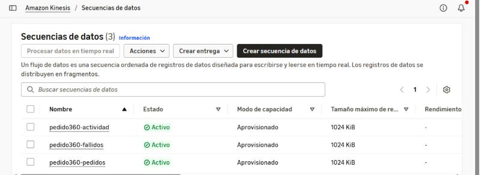

**Qué se ve:** la consola de Kinesis con los tres streams: `pedido360-pedidos`, `pedido360-actividad` y `pedido360-fallidos`, los tres en estado Activo y en modo de capacidad Aprovisionado.

**Qué demuestra:** que existen los dos streams de negocio y el stream de fallidos que pide la pauta. No se crearon a mano: los creó nuestro microservicio administrador con `POST /admin/streams/topologia`, a partir de lo declarado en `application.yml`.

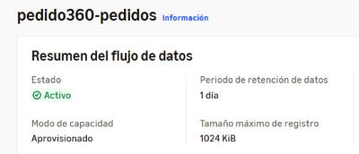

**Qué se ve:** el resumen de `pedido360-pedidos`: estado Activo, retención de 1 día y modo aprovisionado.

**Qué demuestra:** que la configuración del stream coincide con lo que declaramos. Usamos modo aprovisionado porque On-Demand no deja fijar la cantidad de shards.

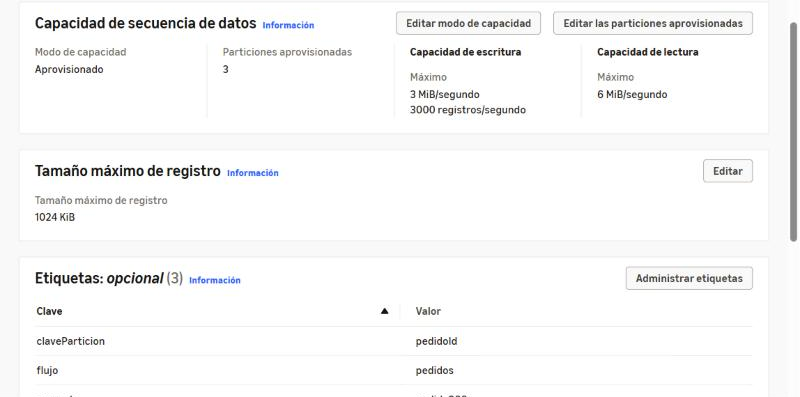

**Qué se ve:** 3 particiones (shards) aprovisionadas, capacidad de escritura de 3 MiB/s y 3.000 registros/s, de lectura de 6 MiB/s, y la etiqueta `claveParticion = pedidoId`.

**Qué demuestra:** los 3 shards pedidos por la pauta. Cada shard aporta 1 MiB/s de escritura y 2 de lectura, por eso se suman 3 y 6. La etiqueta deja documentada en AWS la clave de partición elegida.

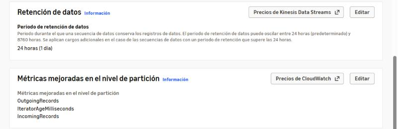

**Qué se ve:** el periodo de retención en 24 horas y las métricas mejoradas a nivel de partición activadas.

**Qué demuestra:** que la retención está configurada (24 h, porque el Learner Lab deniega subirla; lo ideal serían 7 días) y que hay métricas por shard para detectar shards calientes.

## 2. Diseño de los eventos

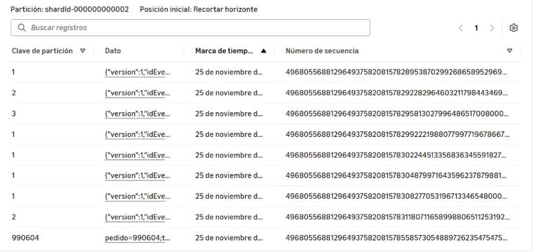

**Qué se ve:** el visor de datos de la consola leyendo un shard de pedidos. Cada fila es un registro con su clave de partición, número de secuencia y hora de llegada. Todos los eventos con clave 1 (el pedido 1) aparecen juntos.

**Qué demuestra:** que la clave de partición `pedidoId` funciona: todos los estados de un mismo pedido caen en el mismo shard y quedan en orden por número de secuencia.

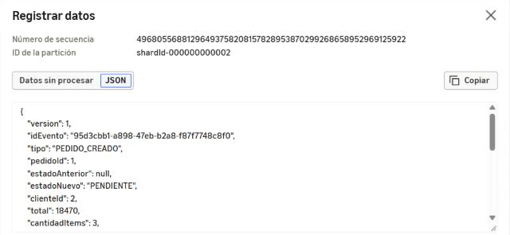

**Qué se ve:** uno de esos registros abierto: un JSON con `version`, `idEvento`, `tipo`, `pedidoId`, estado anterior y nuevo, total, ítems y `ocurridoEn`.

**Qué demuestra:** que el evento es un DTO tipado (`EventoPedidoStream`) serializado en JSON. `idEvento` sirve para la idempotencia, y el evento no lleva nombre ni correo del cliente.

## 3. Flujo exitoso

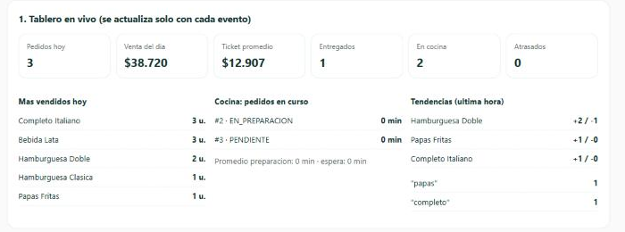

**Qué se ve:** la pestaña Streaming del panel de administración con el tablero de ventas y cocina: 3 pedidos, $38.720 en ventas, 1 entregado y 2 en cocina.

**Qué demuestra:** el flujo completo de punta a punta. El cliente inició sesión con Cognito y pidió por API Gateway. El backend guardó en RDS y publicó en Kinesis, y las aplicaciones consumidoras actualizaron el tablero sin recargar la página.

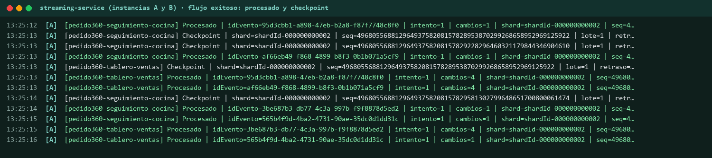

**Qué se ve:** los logs de las instancias A y B: cada evento aparece como procesado por la aplicación de ventas y por la de cocina, con el shard y el número de secuencia, seguido del checkpoint.

**Qué demuestra:** que dos consumer groups leen el mismo evento, cada uno por su cuenta, y que el checkpoint se hace después de procesar y no antes.

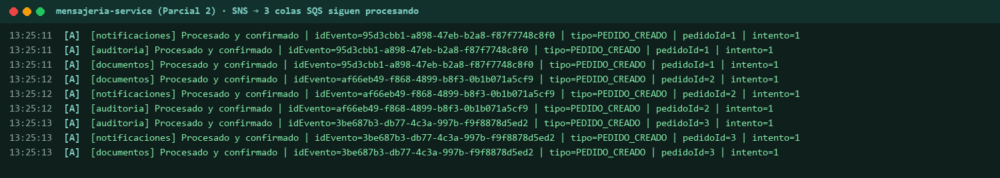

**Qué se ve:** los logs del backend: las tres colas SQS reciben y confirman los mismos pedidos que se publicaron en Kinesis.

**Qué demuestra:** que agregar Kinesis no rompió la mensajería del Parcial 2. El backend publica en SNS y en Kinesis con el mismo `idEvento`.

## 4. Manejo de errores

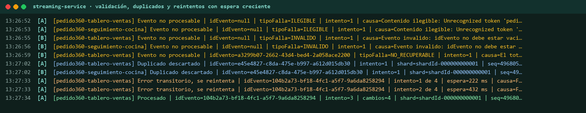

**Qué se ve:** los logs al publicar eventos defectuosos a propósito:
- Uno ilegible (no es JSON).
- Uno inválido (no cumple el DTO, con la lista de campos que fallaron).
- Uno con total incoherente, que ventas rechaza como no recuperable mientras cocina lo procesa.
- Uno duplicado, que se descarta.
- Una falla transitoria: falla, espera 222 ms, falla, espera 432 ms y funciona al tercer intento.

**Qué demuestra:** todas las rutas de error de la pauta. Lo irrecuperable va directo a fallidos y lo transitorio se reintenta con espera exponencial y aleatoria. Los duplicados no se cuentan dos veces, y el shard nunca se detiene.

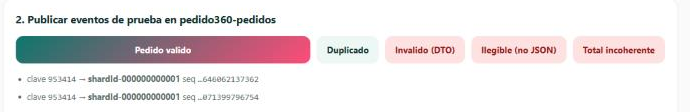

**Qué se ve:** el panel de eventos de prueba al publicar dos veces el mismo evento: los dos registros quedan con la misma clave y en el mismo shard.

**Qué demuestra:** que Kinesis puede entregar el mismo evento más de una vez. La idempotencia es nuestra: la transacción de DynamoDB con la marca `PROCESADO#app/idEvento` hace que solo el primero cuente.

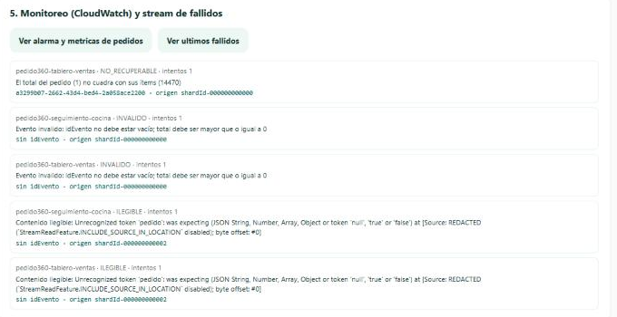

**Qué se ve:** el visor de fallidos de nuestro panel, con los eventos que terminaron en `pedido360-fallidos` y el tipo de falla de cada uno.

**Qué demuestra:** que los fallidos se pueden revisar desde la aplicación, sin entrar a la consola de AWS.

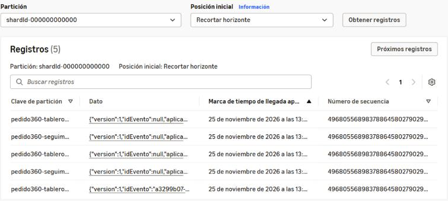

**Qué se ve:** el visor de datos de `pedido360-fallidos` con 5 registros.

**Qué demuestra:** que los eventos defectuosos de la prueba quedaron guardados en el stream de fallidos (dead-letter) y no se perdieron.

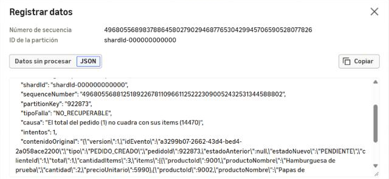

**Qué se ve:** un registro de fallidos abierto: aplicación de origen, stream, shard y número de secuencia de origen, tipo de falla (`NO_RECUPERABLE`), causa y el contenido original del evento.

**Qué demuestra:** que cada fallido guarda todo lo necesario para investigarlo y reprocesarlo.

## 5. Aplicaciones consumidoras y tolerancia a fallos

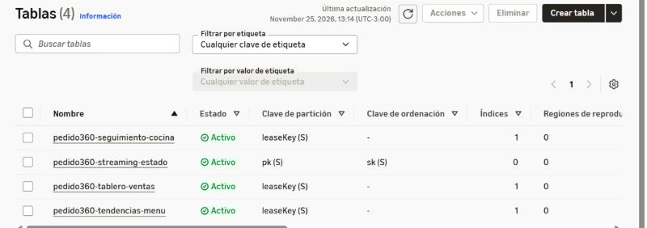

**Qué se ve:** las tablas de DynamoDB: una tabla de coordinación por aplicación (ventas, cocina y tendencias), que crea la KCL, y la tabla de estado `pedido360-streaming-estado`.

**Qué demuestra:** que hay tres consumer groups independientes, cada uno con su propia tabla de coordinación y sus propios checkpoints.

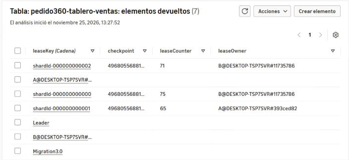

**Qué se ve:** la tabla de coordinación de ventas. Por cada shard: `leaseKey` (el shard), `checkpoint` (hasta dónde se leyó), `leaseCounter` y `leaseOwner` (la instancia que lo lee). B tiene los shards 000 y 002, y A el 001.

**Qué demuestra:** que las dos instancias se reparten los shards de la misma aplicación.

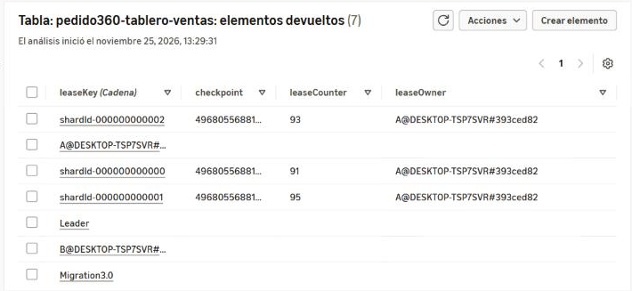

**Qué se ve:** la misma tabla, segundos después de detener la instancia B de golpe: los tres shards ahora tienen como dueño a A, y el `leaseCounter` siguió subiendo.

**Qué demuestra:** la tolerancia a fallos. A tomó los shards de B y siguió desde el checkpoint que había dejado B, sin perder ni repetir eventos.

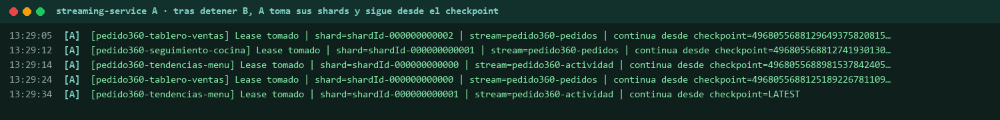

**Qué se ve:** los logs de la instancia A después de detener B. Entre las 13:29:05 y las 13:29:34, A toma uno por uno los leases que tenía B en las tres aplicaciones (ventas, cocina y tendencias). Cada línea dice "continúa desde checkpoint=…", con el número de secuencia que había guardado B.

**Qué demuestra:** el mismo failover desde dentro de la aplicación, con los tiempos exactos: entre unos 35 y 65 segundos después de que B se detuvo, todo quedó en A, sin volver a empezar desde cero.

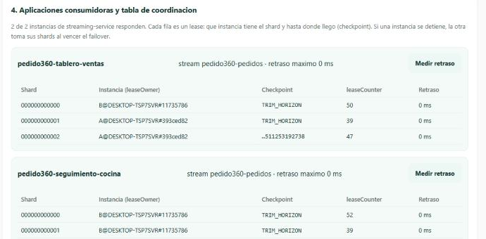

**Qué se ve:** nuestro panel mostrando la tabla de coordinación de cada aplicación: dueño de cada shard, checkpoint y retraso medido, con 0 ms en todos los shards.

**Qué demuestra:** que el microservicio administrador inspecciona las aplicaciones consumidoras y mide su retraso.

## 6. Microservicio administrador: cambios en vivo

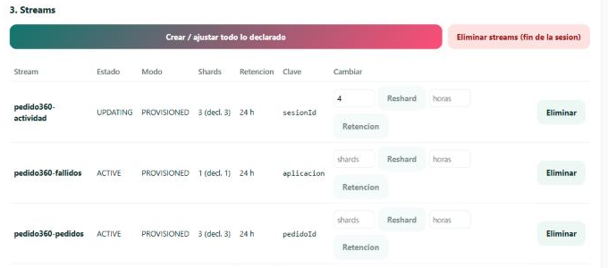

**Qué se ve:** el panel Streaming después de pedir 4 shards para `pedido360-actividad`: el stream aparece en estado `UPDATING`.

**Qué demuestra:** que el administrador cambia la cantidad de shards en vivo, por API REST, sin detener a productores ni consumidores.

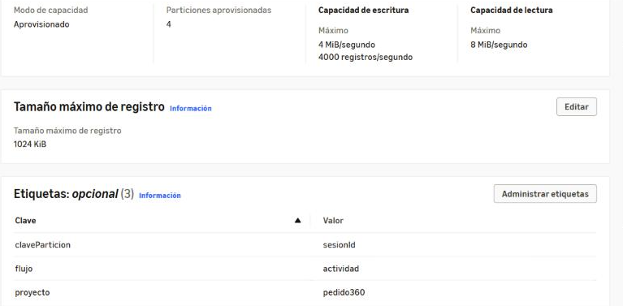

**Qué se ve:** la consola de Kinesis mostrando `pedido360-actividad` con 4 particiones aprovisionadas.

**Qué demuestra:** que el cambio pedido desde nuestro administrador se aplicó de verdad en AWS.

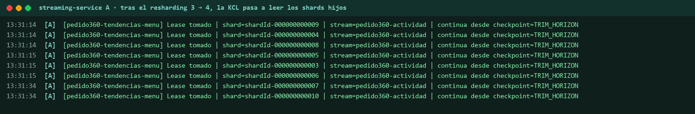

**Qué se ve:** los logs de la instancia A de tendencias después del resharding de 3 a 4 shards: toma por su cuenta los leases de los shards nuevos (hijos, del `shardId-000000000003` al `000000000010`) de `pedido360-actividad` y empieza a leerlos desde el inicio (`TRIM_HORIZON`).

**Qué demuestra:** que los consumidores se adaptan solos al cambio de shards, sin reiniciarlos ni configurarlos. La KCL termina el shard padre antes de pasar a sus hijos, así que el orden por clave se mantiene.

## 7. Supervisión y alarma

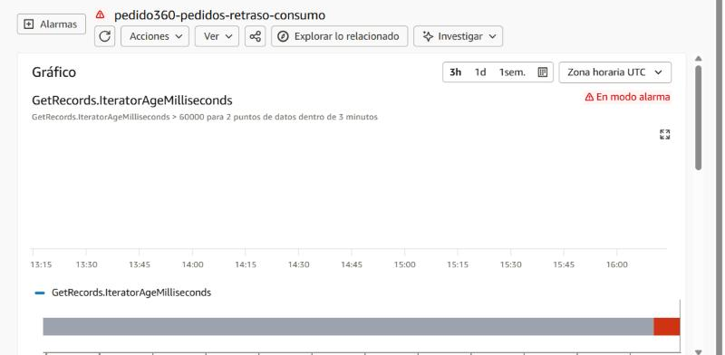

**Qué se ve:** la alarma `pedido360-pedidos-retraso-consumo` en estado En alarma, mientras los consumidores todavía no empezaban a leer.

**Qué demuestra:** que configuramos que la falta de datos cuente como alarma (`treatMissingData = breaching`): si nadie lee el stream, alguien se entera.

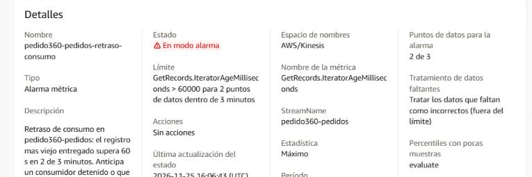

**Qué se ve:** el detalle de la alarma. La métrica es `GetRecords.IteratorAgeMilliseconds` del stream de pedidos y el umbral es más de 60.000 ms en 2 de 3 periodos de 1 minuto.

**Qué demuestra:** la alarma de retraso de consumo que pide la pauta, con un umbral que evita falsas alarmas por un pico aislado.

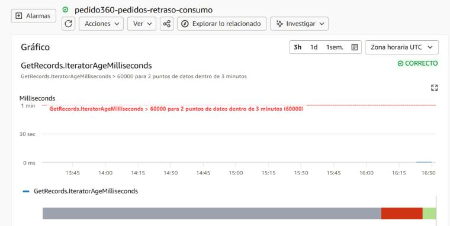

**Qué se ve:** la alarma en estado OK, con el gráfico del retraso en 0, bajo la línea del umbral. Su historial pasa de gris (sin datos) a rojo (alarma) y a verde (OK).

**Qué demuestra:** que la alarma reacciona en las dos direcciones: se activó cuando nadie leía y volvió a OK cuando los consumidores se pusieron al día.

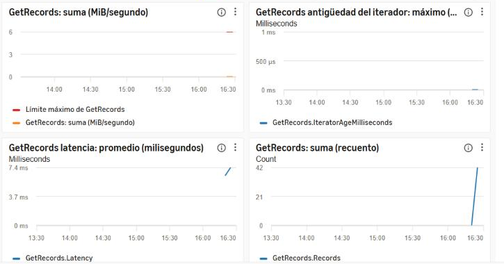

**Qué se ve:** la pestaña de monitoreo de `pedido360-pedidos` en la consola. Tiene cuatro gráficos de lectura (GetRecords):
- volumen leído, muy por debajo del límite;
- antigüedad del iterador en 0 ms;
- latencia de unos 7 ms;
- cantidad de registros leídos, que sube a 42 al hacer los pedidos.

**Qué demuestra:** que los consumidores leen al día. En CloudWatch, por shard, se registraron 2, 3 y 9 registros de entrada y 6, 7 y 29 de lectura. El shard 002 recibió más porque ahí cayeron los 5 eventos del pedido 1, y se lee más del doble porque varias aplicaciones leen cada registro.

## 8. Pruebas automáticas

Además de las pruebas en AWS, el repositorio tiene pruebas automáticas que pasan:
- **streaming-service:** 20 pruebas: rutas de error, reintentos, idempotencia y cada aplicación consumidora.
- **backend:** 3 pruebas: publicación en Kinesis y actividad.
- **admin-service:** 2 pruebas: la topología declarada en la configuración.

Se ejecutan con `mvnw test` en cada servicio.
